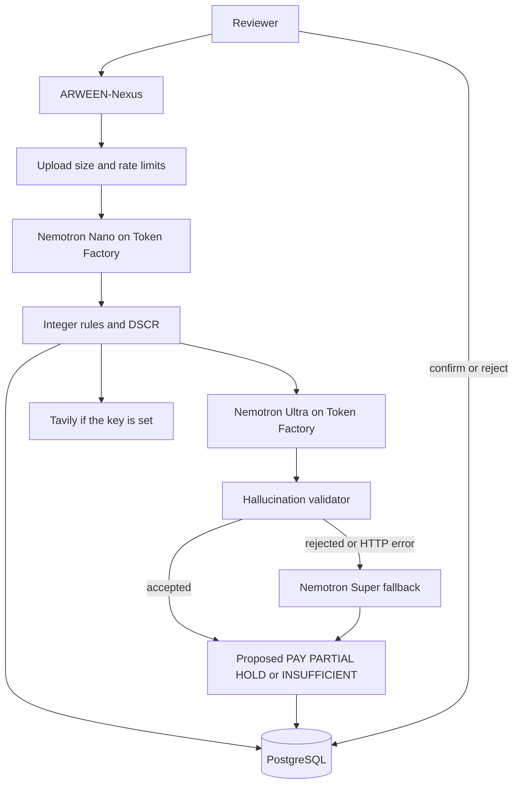

# ARWEEN-Nexus

ARWEEN-Nexus is an evidence and liquidity guardrail for a small business. It reads a supplier invoice, checks whether paying it would break a 1.25 debt-service coverage ratio, and proposes one of four outcomes. A person confirms or rejects that proposal. The app never moves money.

**Live demo:** [https://arween-nexus.vercel.app](https://arween-nexus.vercel.app)

Hosted on Vercel Hobby with Neon Free Postgres. Invoice extraction and Thai/English explanations run on [Nebius Token Factory](https://tokenfactory.nebius.com) with NVIDIA Nemotron. No login is required. The demo is free for judges through the end of the judging period.

UI style inspired by BankDash Dashboard UI Kit (Figma Community).

## Simulated sign-in

Sign-in is simulated. There is no auth provider, no Google OAuth, no email delivery, and no SMS. These screens do not call a paid service. API routes stay open. A password you type for a new account stays in this browser’s `localStorage` and is not sent to the server.

**Try without signing up (Demo mode)** is on the sign-in page. It opens the app with no account and no PDPA step. Judges can use every review feature this way. Login is never required.

A signed-in demo (email and password, one-click fictional user, or Continue with Google) stops on a PDPA page. That page states the purpose, the data collected, the retention, the rights, and a contact, in Thai and English. Accept stays disabled until the checkbox is checked. The consent time is stored in this browser only.

The verification step prints the code on the screen: `Demo code: 123456`. No message is sent.

Fictional accounts, all with password `Demo1234`:

| Name | Email | Phone |
| --- | --- | --- |
| Somsak Demo | demo@arween.test | +66812345678 |
| Mali Fictional | mali@arween.test | +66819876543 |
| Anan Example | anan@arween.test | +66912345678 |

Continue with Google signs in as Niran Google, `niran.google@arween.test`. That account has no password. The consent contact, `privacy@arween.test`, is fictional and is not monitored.

The session is the `arween-session` value in `localStorage`. A same-site cookie named `arween-demo` only records `guest` or `user`. It is not a credential.

| Outcome | Meaning |
| --- | --- |
| `PAY` | Pay the invoice in full. Coverage stays at or above 1.25. |
| `PARTIAL` | Pay only the capped amount that still clears 1.25. |
| `HOLD` | Do not pay. A blocking rule failed, or the safe cap is not positive. |
| `INSUFFICIENT` | Required fields are missing, the currency does not match, or extraction confidence is under 80%. |

Fault is not assigned (`fault_determination = NOT_PERFORMED`).

Track: **Best Apps & Agents** only, Nebius x NVIDIA Global AI Hackathon. Behavior follows ARWEEN-NEXUS-TMS-001 (18 October 2026).

## Why

A small firm in Thailand can be one paid bill away from missing a loan covenant. The invoice, the supplier’s tax id, and next period’s cash are usually checked in different places, and a model that “does the math” can invent a figure. ARWEEN separates those jobs. Nemotron reads and explains. Integer code decides. A person approves.

## How we use NVIDIA Nemotron on Nebius Token Factory

Token Factory is the only inference path. The app sends OpenAI-compatible chat completions to the public pool:

```text
POST https://api.tokenfactory.nebius.com/v1/chat/completions
Authorization: Bearer ${NEBIUS_API_KEY}
```

`NEBIUS_BASE_URL` defaults to `https://api.tokenfactory.nebius.com/v1`. No GPU is rented for these calls. The model ids below were taken from the public catalog at `https://tokenfactory.nebius.com/api/public/models_info` on 18 October 2026.

| Job | Model id | Why this model |
| --- | --- | --- |
| Invoice JSON | `nvidia/NVIDIA-Nemotron-3-Nano-30B-A3B` | Fast, cheap extraction. Nano is text-only in the catalog. |
| Thai and English explanation | `nvidia/Nemotron-3-Ultra-550b-a55b` | The reasoning step. It must not invent amounts. |
| Explanation fallback | `nvidia/nemotron-3-super-120b-a12b` | Used only if Ultra errors or the hallucination check rejects the text. |
| Photo transcription | `nvidia/Nemotron-3.5-Super-VL` | Used only for a PNG, JPEG, or WEBP. The transcript then goes to Nano. |

Token Factory accelerated the workflow in a concrete way. One HTTPS endpoint and one API key serve four NVIDIA open models. Switching from Nano to Ultra is a different `model` field on the same request shape, so the extract and explain steps did not need separate serving stacks. The outcome is still computed in `lib/engine` with `bigint`. The model is not asked to calculate DSCR.

### Measured live runs

These rows are `model_invocations` from live Token Factory calls on 18 October 2026. Every stored Nemotron call in that set was `accepted = true`. Nemotron 3 Super was not called, because Ultra passed the hallucination check. No image was sent, so Super VL was not called. `TAVILY_API_KEY` was unset, so each counterparty check is `not_verified` and `RULE-WEB-001` does not block.

The run that matches the spec, after the extractor was told to copy `quantity_millis` unchanged:

| Case | Outcome | Winning rule | Nano extract | Ultra explain | Tokens (prompt + completion) |
| --- | --- | --- | --- | --- | --- |
| A · INV-1044 Harbor Supplies · 37,450.00 THB | `PAY` | `RULE-PAY-001` | 2,627 ms · 665 + 704 | 3,289 ms · 1,134 + 998 | 3,501 |
| B · INV-2208 Harbor Supplies · 60,000.00 THB | `PARTIAL` 45,000.00 THB | `RULE-DSCR-001` | 2,011 ms · 634 + 584 | 2,467 ms · 1,173 + 903 | 3,294 |
| C · INV-9001 Vanta Commerce · 60,000.00 THB | `HOLD` | `RULE-INV-001` | 2,216 ms · 635 + 671 | 2,032 ms · 1,077 + 565 | 2,948 |

Case A full payment leaves DSCR `1.3255`. Case B full payment drops DSCR to `1.1000`, so the proposal is the 45,000.00 THB cap, which leaves DSCR `1.2500`. Case C is a duplicate of the seeded anchor invoice. A separate live invoice with confidence at 79% returned `INSUFFICIENT` on `RULE-DATA-001` (Nano 2,519 ms, 631 + 611; Ultra 1,832 ms, 1,057 + 529).

Across all 22 stored calls that day, Nano latency was 2.0–5.3 s and Ultra latency was 1.8–4.2 s. The same case B extract was 2.0 s, later 5.3 s, then 3.9 s. Completion length moved with it. The first case B, before the quantity prompt fix, was a correct `HOLD` on `RULE-INV-002` because Nano had rewritten a quantity. Details are in [docs/FEEDBACK.md](docs/FEEDBACK.md).

List prices on the catalog that day: Nano `$0.06 / $0.24` per million input/output tokens, Super and Super VL `$0.30 / $0.90`, Ultra `$1 / $3`. A text review like case A is about `$0.005`.

## What it does

1. The reviewer drops a PDF, image, text, or JSON invoice, or clicks sample A, B, or C. Companies and amounts in the samples are fictional.
2. Nano returns invoice JSON. A strict parser accepts only labeled integers. Nothing is guessed.
3. Confidence below 80% (8,000 bps), a missing required field, or a currency mismatch stops at `INSUFFICIENT`.
4. Seven rules run in order. DSCR uses integer satang and a 1.25 threshold (`1_250_000` micros).
5. If `TAVILY_API_KEY` is set, Tavily is queried with the supplier legal name and tax id only. If it is empty, the check is stored as `not verified` and does not block.
6. Ultra writes the Thai and English explanation from the computed result. The hallucination validator rejects new digits and unknown rule ids. A failure retries on Super, then falls back to a deterministic template.
7. The screen shows three scenarios (hold, pay in full, partial max), the winning rule, and the evidence. **Approve** or **Reject** records the person’s choice. **Hold** leaves the proposal open. No transfer is created.

## Architecture



Money, tax, and DSCR live in `lib/engine` and use `bigint` only. `decide()` writes the outcome. Model text does not.

## Test cases A, B, and C

Shared cash assumptions, in satang: cash in `25,000,000`, operating cash out `8,000,000`, principal due `8,000,000`, interest due `2,000,000`. Debt service is `10,000,000`. The safe payment cap at DSCR 1.25 is `4,500,000` (45,000.00 THB).

| Case | Invoice | What you should see |
| --- | --- | --- |
| A | Harbor Supplies `INV-1044`, 37,450.00 THB | `PAY` on `RULE-PAY-001`. DSCR after full payment `1.3255`. |
| B | Harbor Supplies `INV-2208`, 60,000.00 THB | `PARTIAL` on `RULE-DSCR-001`. Pay up to 45,000.00 THB. Full payment would leave DSCR `1.1000`. |
| C | Vanta Commerce `INV-9001`, 60,000.00 THB | `HOLD` on `RULE-INV-001`, because the seeded anchor invoice has the same number. Line math also fails `RULE-INV-002`. |

On the demo, open [the app](https://arween-nexus.vercel.app), leave the language on **EN**, and click **Run sample A**, then B, then C. Each click calls Token Factory and takes a few seconds. Then open **History & Audit** and select the row. The trail shows `Nemotron Nano` and `Nemotron 3 Ultra` with latency and token counts. Switch **TH**. The explanation is already in Thai. That toggle does not call the model again.

`npm test` locks the same three cases, the confidence gate, a non-positive cap, the price warning, the hallucination validator, and the sample parser. Those tests do not call Token Factory.

## Safety design

- **Integer money.** Amounts are satang (`bigint`). DSCR micros are `cash_available * 1_000_000 / debt_service`. The 1.25 test is `cash_available * 100 >= debt_service * 125`.
- **Confidence gate.** Below 80%, the outcome is `INSUFFICIENT` on `RULE-DATA-001`. A live 79% invoice did this.
- **No guessed fields.** The parser rejects JSON that is not labeled integers. A failed extract does not invent a total.
- **Hallucination validator.** The explanation may cite only evaluated rule ids and amounts that already exist on the result, including the 1.25 threshold. A rejected explanation is stored with `accepted = false` and replaced.
- **Human approval.** Status stays `proposed` until confirm or reject. The screen says no money moves. Hold does not create a new status.
- **Audit log.** Every review stores the model id, latency, token counts, the retrieval provider, and the human action.
- **Demo limits.** Defaults: 8 MB upload, 6 analyze requests per IP per minute, 30 Nemotron calls per IP per UTC day, 80 calls per day for everyone, and `$0.30` of estimated Token Factory spend per UTC day. A request that would cross a cap returns HTTP 429 and does not call Token Factory. The JSON body has `code` (`RATE_LIMIT_PER_IP`, `DAILY_IP_CAP`, `DAILY_CALL_CAP`, or `DAILY_BUDGET`), `retryAfterSeconds`, and `resetsAt`. The screen shows that message in English or Thai and says the daily quota resets at 00:00 UTC. Confirm, reject, and cash edits are rate-limited separately and do not call a model.

The defaults stay at 80 calls and `$0.30` per UTC day. For the judging window, 1–15 December 2026, raise them in the host’s environment and redeploy. `DEMO_DAILY_CALL_CAP=200` and `DEMO_DAILY_BUDGET_USD=1.00` is a higher public quota. `$1` per day for those 15 days is about `$15` of Token Factory spend if the cap is hit every day, so pick a pair that fits the remaining balance. The per-minute limit and the per-IP daily cap stay on their own variables.

`gps_verified` is always null and is not used. Escrow, milestone payout, integrity snapshots, and network membership are not implemented.

## Tavily

Tavily is optional. The query is only the supplier’s legal name and tax id (`lib/tavily/query.ts`). Totals and cash figures are not sent.

- Key set: `POST https://api.tavily.com/search`. `tax_id_found` is true only when a returned title, snippet, or URL contains that tax id. A completed search that misses the id fails `RULE-WEB-001` and the outcome is `HOLD`.
- Key empty: provider `not_verified`, no evidence rows, and the rule is a warning. The screen says not verified. It does not invent a registry hit, and it does not pretend the search failed.

The recorded runs used the empty-key path. A live Tavily call is not claimed.

## Setup

Requirements: Node.js 22 and PostgreSQL 16.

### Local

```bash
cp .env.example .env.local
# set DATABASE_URL if Postgres is not on localhost
npm install
npm test
npm run dev
```

Open [http://127.0.0.1:43123](http://127.0.0.1:43123). Leave both API keys empty for the labeled-text demo, which does not call Nemotron. Set `NEBIUS_API_KEY` to use Token Factory.

On an empty database the process creates the schema and seeds Baan Suan Studio, the spec cash and debt figures, the Cartons price ceiling (300.00 THB), and anchor invoice `INV-9001` for fictional Vanta Commerce. Sample decisions are not pre-inserted. Clicking A, B, or C creates them.

### Docker Compose

```bash
docker compose up --build
```

Postgres and the production Next.js image start together. The app listens on port `43123`. `GET /api/health` checks Postgres. The container health check calls that route.

### Vercel and Neon

The public demo uses this layout. Inference stays on Token Factory either way.

1. Create a Neon Free project and copy the pooled connection string. It must include `sslmode=require`.
2. Import the GitHub repository into a Vercel Hobby project. Framework preset: Next.js.
3. Set the environment variables below for Production. Do not commit `NEBIUS_API_KEY` or `DATABASE_URL`.
4. Deploy. The first request runs the schema and seed.
5. Open `/api/health`. A healthy process returns `{ "ok": true }` plus the public demo limits. If Neon is waking up, the route retries the connection and then answers. A failure is HTTP 503 JSON, not a model call.
6. `vercel.json` registers one Vercel Cron, `15 5 * * *` (05:15 UTC, once a day, which is what Hobby allows). It calls `GET /api/keepalive`. That route runs `SELECT 1` and retries while the compute wakes. It does not read an invoice and it does not call Nemotron. A daily ping keeps the free database from sitting idle for days. A review after the compute has already slept can still wait a few seconds on the same retry.

`maxDuration` on the analyze route is 300 seconds, which fits Vercel Hobby. A text review in the measured runs finished in well under that. Health and keepalive allow 60 seconds so a cold database can finish its retries.

## Environment

| Variable | Purpose |
| --- | --- |
| `DATABASE_URL` | PostgreSQL connection string. Required in production. |
| `NEBIUS_API_KEY` | Token Factory key. Empty = labeled parser and template text. Create one at [tokenfactory.nebius.com](https://tokenfactory.nebius.com). |
| `NEBIUS_BASE_URL` | OpenAI-compatible base. Default `https://api.tokenfactory.nebius.com/v1`. |
| `NEBIUS_EXTRACT_MODEL` | Nano model id. |
| `NEBIUS_EXPLAIN_MODEL` | Ultra model id. |
| `NEBIUS_EXPLAIN_FALLBACK_MODEL` | Super model id. |
| `NEBIUS_VISION_MODEL` | Super VL model id for images. |
| `TAVILY_API_KEY` | Tavily key. Empty = not verified, no invented result. |
| `DEMO_MAX_UPLOAD_BYTES` | Upload cap. Default `8388608` (8 MB). |
| `DEMO_MAX_PASTE_CHARS` | Pasted text cap. Default `200000`. |
| `DEMO_RATE_LIMIT_PER_MINUTE` | Analyze requests per IP per minute. Default `6`. |
| `DEMO_MUTATION_RATE_LIMIT_PER_MINUTE` | Confirm, reject, assumption, and reset requests per IP per minute. Default `30`. |
| `DEMO_DAILY_CALL_CAP` | Nemotron HTTP calls per UTC day. Default `80`. When set, this wins over `DEMO_DAILY_NEMOTRON_CALLS`. |
| `DEMO_DAILY_NEMOTRON_CALLS` | Same call cap, kept so an older environment still works. Default `80`. |
| `DEMO_IP_DAILY_NEMOTRON_CALLS` | Nemotron HTTP calls per IP per UTC day. Default `30`. |
| `DEMO_DAILY_BUDGET_USD` | Estimated Token Factory spend per UTC day, in dollars. Default `0.30`. When set, this wins over `DEMO_DAILY_USD_MICROS`. |
| `DEMO_DAILY_USD_MICROS` | Same spend cap, in millionths of a dollar. Default `300000` (`$0.30`). |
| `PG_POOL_MAX` | Postgres connections per process. Default `3`. |

## Built during the submission period

The hackathon submission period started on 26 August 2026. Before that, only the concept and spec document existed. All of the application code in this repository was written during the submission period.

## License

MIT. Copyright 2026 THANAMETHAWAT SRIPITAK. See [LICENSE](LICENSE).
